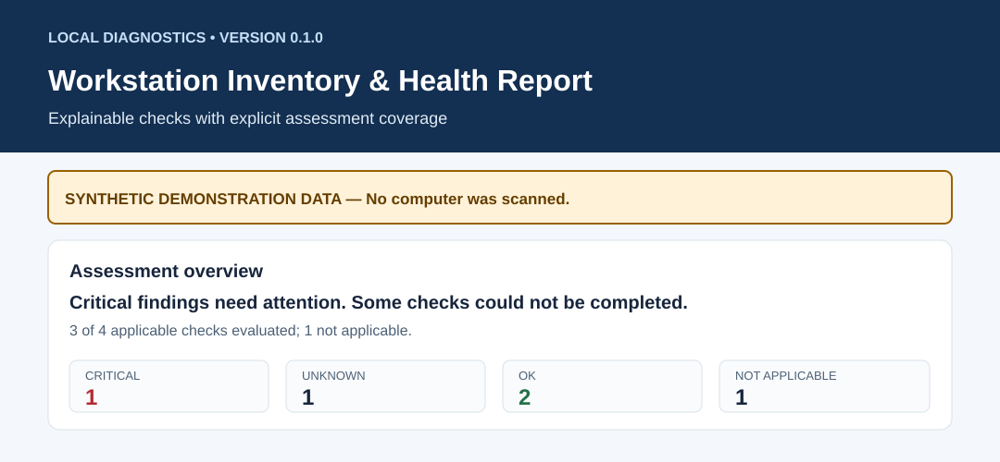
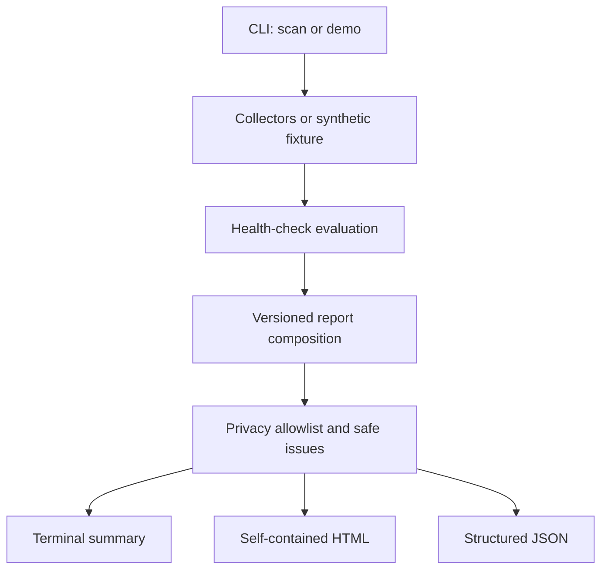

# Workstation Inventory & Health Report

**Know what your workstation reports — and what a quick health check cannot tell you.**

[](https://github.com/jordaninjohnson/workstation-health-report/actions/workflows/ci.yml)
[](pyproject.toml)
[](LICENSE)
[](https://github.com/jordaninjohnson/workstation-health-report/releases/tag/v0.1.0)

A **privacy-first, read-only Python command-line application** for collecting basic hardware and operating-system inventory, evaluating a small number of resource thresholds, and generating understandable **HTML and JSON reports**. Designed for people learning computer troubleshooting, IT technicians who need a local snapshot, and developers exploring practical Python automation.

It is free to explore, use, fork, and improve under the [MIT license](LICENSE). New to Python? Start with the [no-scan demo](#try-it-without-scanning-your-computer). Know your way around a terminal? Jump to the [quick start](#quick-start-windows-11).

> [!IMPORTANT]
> This is an **inventory and diagnostic aid**, not an antivirus, vulnerability scanner, SMART disk-health test, compliance tool, benchmark, or guarantee of system security or reliability. An `OK` result means **only** that an evaluated rule did not cross its threshold at the moment of the scan.

## See a report before you install

[](examples/synthetic-attention-needed.html)

**The examples are 100% synthetic.** They do not contain a scan of the author's computer, a CI runner, or anyone else's machine.

| Sample | What it demonstrates | Files |
| --- | --- | --- |
| **Healthy workstation** | Evaluated checks with no issues detected, plus explicit coverage information | [HTML](examples/synthetic-healthy.html) · [JSON](examples/synthetic-healthy.json) |
| **Attention needed** | Low disk space and an unavailable Windows Defender check; an unknown is **not** a pass | [HTML](examples/synthetic-attention-needed.html) · [JSON](examples/synthetic-attention-needed.json) |

> GitHub often displays HTML files as source code. To see the formatted report, download the HTML sample and **open it locally in a browser**. The report contains its own CSS and makes no external network requests. See the [three-minute demonstration](docs/DEMO.md).

## What can it do?

| Area | Currently implemented | What the numbers **do not** prove |
| --- | --- | --- |
| **System** | OS name/version, architecture, kernel/build, Python and tool versions, boot time and uptime when available | A supported OS version is fully patched |
| **Hardware** | CPU label and core counts, RAM totals/availability, manufacturer/model and battery when exposed by supported APIs | Hardware components are fault-free or battery wear is low |
| **Storage** | Usable local filesystem capacities, free space and documented warning/critical rules | Disk media is healthy or files are backed up |
| **Resources** | A timed CPU sample, memory snapshot and battery charging state | A brief spike means sustained workload trouble |
| **Networking** | Interface count, operational state and reported link speed, without addresses | Internet access, link throughput or a secure connection |
| **Reporting** | Terminal summary, standalone responsive HTML and schema-versioned JSON | A single numeric score of machine health |
| **Privacy** | Fixed report-field allowlist, sanitized collection errors and no telemetry | Real reports cannot contain *any* sensitive operational context |

Unavailable measurements remain unavailable. The tool never converts missing evidence into a fabricated value or an `OK` check.

## Quick start: Windows 11

**Requirements:** Python **3.10+**, `pip`, and permission to assess the computer. Python must be installed before running these commands. An internet connection may be necessary **to install Python packages**; it is not needed for scans. Run as a normal user. Do not install or run this on a device without authorization.

1. Download the repository using **Code → Download ZIP** on GitHub, then extract it (or clone using Git). Open **PowerShell in the extracted project folder** — the directory containing `pyproject.toml`.
2. Copy these commands into PowerShell:

```powershell
py -3 -m venv .venv
.\.venv\Scripts\python.exe -m pip install -e .
.\.venv\Scripts\python.exe -m workstation_health scan --output reports --format html,json
```

3. Open `reports/workstation-health.html` from that folder. The accompanying `reports/workstation-health.json` contains the same report data for scripts.

Using `.venv\Scripts\python.exe` directly avoids changing PowerShell execution policies to activate a virtual environment. After installation, you can also use `.venv\Scripts\workstation-health.exe` as the CLI executable. If `py -3` is unavailable, verify the Python launcher or use the path to an installed Python 3.10+ interpreter.

> **Prefer a demonstration first?** Replace `scan` with `demo --scenario attention-needed` and use a fresh output directory. Demo mode does not collect host inventory.

## Linux and macOS setup

```bash
# From the repository root
python3 -m venv .venv
.venv/bin/python -m pip install -e .
.venv/bin/python -m workstation_health scan --output reports --format html,json
# Open reports/workstation-health.html locally
```

Linux runtime behavior has been exercised in an isolated development environment; **macOS behavior has not been verified on actual hardware**. See the [platform matrix](#platform-support-and-verification).

## Versioned release download

[**v0.1.0 release notes and downloads**](https://github.com/jordaninjohnson/workstation-health-report/releases/tag/v0.1.0) include a built Python wheel alongside GitHub’s source archives. To install the downloaded wheel into an active virtual environment, run `python -m pip install ./workstation_health_report-0.1.0-py3-none-any.whl`. Installation may fetch `psutil`; running a scan does not contact the network. The wheel is not a standalone executable and requires Python.

## Try it without scanning your computer

Synthetic reports are ideal for an interview demo, evaluating the layout, or contributing without publishing real workstation information:

```bash
# After installing, on any supported Python host:
python -m workstation_health demo --scenario healthy --output demo-healthy
python -m workstation_health demo --scenario attention-needed --output demo-attention

# Generate both examples in one directory:
python -m workstation_health demo --output demo-reports
```

Every demo is prominently marked **SYNTHETIC** in its report. Running `demo` does not call the host collectors. Paths `demo-healthy/`, `demo-attention/` and `demo-reports/` are local output directories; **never commit actual scan reports**.

## CLI reference

Once you have activated your virtual environment, or by using the equivalent `.venv` Python executable:

```bash
workstation-health --help
workstation-health --version
workstation-health scan --help
workstation-health demo --help

workstation-health scan --output reports --format html,json
workstation-health scan --output json-only --format json
workstation-health demo --scenario attention-needed --output demo-reports

# An example of customized free-space thresholds:
workstation-health scan --output custom-report \
  --disk-warning-percent-free 20 --disk-critical-percent-free 7
```

**Output safety:** An existing report is **not overwritten by default**. Choose a new output directory, or intentionally pass `--overwrite`. A warning or critical finding does not mean the application crashed: exit `0` means the requested files were generated, `2` means invalid usage/configuration or an output collision, and `1` means an execution failure. These codes are not health scores.

### Example terminal summary — synthetic

```text
Created: demo-reports/synthetic-attention-needed.html
Created: demo-reports/synthetic-attention-needed.json
SYNTHETIC synthetic-attention-needed: Critical findings need attention. Some checks could not be completed. 3 of 4 applicable checks evaluated; 1 not applicable.
```

A low-space alert and an unavailable assessment can coexist. Read the individual evidence and limitations rather than relying on the headline alone.

## How to interpret findings

| Status | Meaning | Recommended approach |
| --- | --- | --- |
| `OK` | Available evidence was evaluated; this specific rule was not triggered | Treat as a limited snapshot, not broad reassurance |
| `WARNING` | A documented attention threshold was crossed | Review evidence and suggested next step |
| `CRITICAL` | A higher-priority threshold was crossed | Prioritize review; verify with system tools |
| `UNKNOWN` | Evidence missing, unsupported, inaccessible, or the provider is deliberately deferred | Do **not** treat as healthy; inspect why it could not be evaluated |
| `NOT_APPLICABLE` | The check does not apply to this scenario | Excluded from applicable-check coverage |

**Coverage:** `evaluated = OK + WARNING + CRITICAL`; applicable checks = evaluated + `UNKNOWN`. `NOT_APPLICABLE` checks are excluded. Critical findings take precedence over warnings; when checks are unavailable, the headline explicitly mentions the gap. There is **no synthetic “health score.”**

**Default capacity rule:** storage warning when free space is **≤15% OR ≤10 GiB**, critical when **≤5% OR ≤2 GiB**; critical takes precedence. Equality triggers the threshold. CPU and memory thresholds use the percentages documented in [health checks](docs/HEALTH_CHECKS.md), with command-line overrides where provided. CPU uses an actual blocking sample interval (default 0.25 seconds). Neither a short CPU sample nor one memory snapshot diagnoses a long-running performance problem.

## Platform support and verification

| Capability | Windows 11 (primary target) | Linux | macOS |
| --- | --- | --- | --- |
| OS, core counts, RAM, CPU sample | Implemented; mocked tests; **real Windows validation pending** | Implemented; isolated Linux scan | Best effort; **real-device validation pending** |
| CPU model | Windows registry fallback | `/proc/cpuinfo` fallback | Platform API fallback; unverified |
| Manufacturer/model | Read-only CIM query with timeout | Accessible DMI files, if present | Not implemented |
| Local volumes | `psutil` and mount exclusion heuristics | `psutil` and mount exclusion heuristics; containers can report none | Best effort; unverified |
| Link state/speed | `psutil`; real-device validation pending | `psutil` | `psutil`; unverified |
| Battery | `psutil`, if exposed by the host | `psutil`, if exposed | `psutil`; unverified |
| Microsoft Defender | Explicitly `UNKNOWN` on Windows, not assessed | Not applicable | Not applicable |
| Windows Firewall / BitLocker | Not implemented | Not applicable | Not applicable |

**Evidence matters:** Passing unit tests with mocked Windows APIs on Linux is not proof the collectors work on a Windows 11 laptop. The workflow in [`.github/workflows/ci.yml`](.github/workflows/ci.yml) runs Windows and Linux *test jobs*, not a privileged hardware audit. Consult the live CI badge above for GitHub's current results; a green CI badge does not replace real-device validation.

## Privacy first, by default

The scanner deliberately **does not request or display**: username, hostname, IP/MAC addresses, SSIDs, DNS/domain details, hardware serial numbers or UUIDs, personal files, browser data, credentials/tokens, environment variables, installed-application inventories, process lists or process command lines. It does not ping networks, upload a report, or modify security settings. Manufacturer/CPU strings are sanitized and written through an output-field allowlist; errors use safe categories rather than exposing raw exception paths or command output.

External command execution (where used) is read-only, uses an argument list instead of shell interpolation, and is bounded by a command timeout. Some operating-system filesystem queries may still block unexpectedly; timeout coverage is not absolute.

**Actual reports remain private by default**, but hardware characteristics and resource snapshots can be sensitive in some contexts. Review reports before sharing. Publish or file issues with **synthetic fixtures and sanitized descriptions**, never raw scans. See [privacy and threat considerations](docs/PRIVACY.md) and [security reporting](SECURITY.md).

## Design and JSON contract

The application keeps responsibilities separate:



`collect.py` gathers facts with `psutil` and targeted platform helpers; `privacy.py` filters allowed fields and sanitizes failures; `evaluate.py` assigns rule-based findings; `report.py` composes the report; `render.py` formats escaped, network-independent HTML; and `cli.py` validates options and writes the requested files. The synthetic `demo.py` supplies deterministic example observations. See [architecture](docs/ARCHITECTURE.md) and the hands-on [learning guide](docs/LEARNING.md).

The UTF-8 JSON document identifies `schema_version: "1.0"`. It uses explicit capacities in **bytes**, resource percentages (0–100), network link speed in **Mbps**, and timestamps with timezone offsets. `null` means *unknown/unavailable*, not zero. Example (shortened from the documented schema, not an exhaustive report):

```json
{
  "schema_version": "1.0",
  "scan": { "timestamp": "2026-01-15T10:30:00-07:00", "privacy_mode": "default-minimal", "synthetic": true, "scenario": "healthy" },
  "summary": { "status_counts": { "OK": 3, "WARNING": 0, "CRITICAL": 0, "UNKNOWN": 0, "NOT_APPLICABLE": 1 } }
}
```

The illustrative fragment above is **not a complete valid report**; consult the actual [healthy JSON example](examples/synthetic-healthy.json), [attention-needed JSON](examples/synthetic-attention-needed.json), and [field reference](docs/SCHEMA.md) for canonical field names and structure. The published schema is a documented contract; a separate machine-validating JSON Schema file is a future improvement.

## Develop and test

```bash
# From the repository root, in an activated virtual environment
python -m pip install -e ".[dev]"
python -m pytest -q
ruff check .
ruff format --check .
python -m compileall -q src
python -m workstation_health demo --output demo-reports
```

The tests use fixtures and mocks for errors, boundary values and platform-specific behavior so that contributions can be checked **without inspecting developer hardware**. Test coverage is not advertised as a measured percentage. The GitHub Actions workflow runs the suite and a synthetic CLI smoke test on Windows and Linux with read-only repository token permissions. See [CONTRIBUTING.md](CONTRIBUTING.md) for a complete fork-to-PR walkthrough.

## Contributing: Help make this project better

**Forks, bug reports, questions, documentation fixes, accessibility improvements, tests and careful new diagnostics are welcome.** You do **not** need to be an expert programmer. Improving one confusing error message or writing one deterministic test is a valuable contribution.

A typical path is **Fork → Clone your fork → Create a branch → Change and test → Open a pull request**. Please read the [contributor guide](CONTRIBUTING.md), use the [issue templates](.github/ISSUE_TEMPLATE/), and follow the [pull request checklist](.github/PULL_REQUEST_TEMPLATE.md). Describe platform behavior honestly and use **synthetic**, not personal, system data. For vulnerabilities, follow [SECURITY.md](SECURITY.md) instead of opening a public issue with sensitive details.

If you want a small place to start, consider: improving Windows installation troubleshooting, adding a synthetic edge-case test for unavailable CPU evidence, or improving accessible text in the report. See the [starter contribution ideas](CONTRIBUTING.md#starter-contribution-ideas) or browse [good-first issues](https://github.com/jordaninjohnson/workstation-health-report/issues?q=is%3Aissue+is%3Aopen+label%3A%22good+first+issue%22) for manageable scopes.

## Roadmap (not yet implemented)

**Next practical work:** verify Windows 11 collectors on authorized hardware, document any differences, clarify installation errors, and expand cross-platform fixtures.

**Possible later work:** evaluate safe opt-in Windows Defender/firewall/encryption reporting with trustworthy read-only evidence; improve removable-media identification; publish a formal JSON Schema; add more synthetic report accessibility checks; consider a portable distribution.

These are **ideas, not promises**, and none is evidence that the feature currently exists. Proposals should include privacy implications, tests, and what evidence an output genuinely supports.

## Skills demonstrated

| IT / software skill | Where to look |
| --- | --- |
| Hardware and OS inventory | [`collect.py`](src/workstation_health/collect.py) and platform helpers |
| Systems and network concepts | Filesystem filtering, CPU/memory samples, interface status and speed |
| Security-aware design | [`privacy.py`](src/workstation_health/privacy.py), sanitized errors, read-only operation |
| Python automation and packaging | [`cli.py`](src/workstation_health/cli.py), [`pyproject.toml`](pyproject.toml), JSON/HTML rendering |
| Testing and CI | [`tests/`](tests/), [CI workflow](.github/workflows/ci.yml) |
| Technical communication | Explainable findings, [health thresholds](docs/HEALTH_CHECKS.md), [three-minute demo](docs/DEMO.md) |

This is an independent educational portfolio project. **No enterprise deployment, customer adoption, professional security assessment or measured business savings is claimed.**

## Documentation and project stewardship

[Architecture](docs/ARCHITECTURE.md) · [Health checks and thresholds](docs/HEALTH_CHECKS.md) · [JSON field contract](docs/SCHEMA.md) · [Privacy](docs/PRIVACY.md) · [Troubleshooting](docs/TROUBLESHOOTING.md) · [Interview demo](docs/DEMO.md) · [Learning guide](docs/LEARNING.md) · [Contributing](CONTRIBUTING.md) · [Security reporting](SECURITY.md) · [Changelog](CHANGELOG.md)

Created and maintained as an independent learning and portfolio project by **Jordan I. Johnson**. Licensed under [MIT](LICENSE): you may use, modify, distribute and fork the project subject to the license's attribution and warranty-disclaimer terms. The project makes no guarantees about fitness for a particular purpose. Dependency acknowledgments and licensing remain with their respective owners; the primary runtime dependency is [`psutil`](https://psutil.readthedocs.io/).